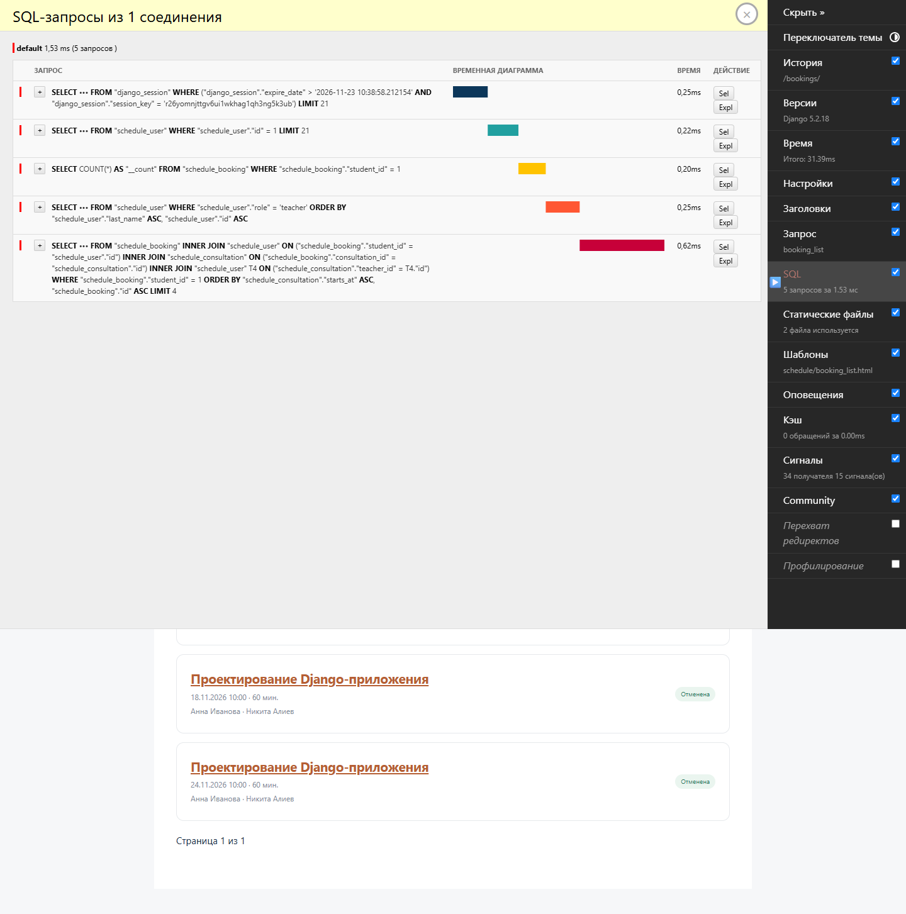

# Практическая работа №10

**Административная панель Django и работа с данными через ORM.** Алиев Никита, ЭФБО-01-24, 2026 г.

Дисциплина: «Технологии разработки приложений на базе фреймворков». Проект: «Система управления консультациями».

## Цель

Настроить управление связанными объектами в Django Admin, расширить ORM-запросы и проверить их выполнение и количество SQL-запросов.

## Выполненная работа

Зарегистрированы `User`, `Consultation` и `Booking`. Настроены столбцы, поиск по связанным полям, фильтры, сортировка, выбор преподавателя через autocomplete, календарная иерархия и просмотр записей внутри консультации. Для чтения связей используется `list_select_related`; число записей вычисляется аннотацией `Count`.

Админка сохраняет бизнес-правила: преподавателем нельзя назначить студента; время и преподавателя консультации с записями нельзя менять напрямую; запись создаётся через пользовательскую форму. Записи доступны для просмотра и действий отмены/завершения, физическое удаление истории отключено. Завершать можно только уже закончившиеся встречи. Изменения расписания сбрасывают кэш после фиксации транзакции.

Статусы реализованы через `Booking.Status(TextChoices)`: `active`, `cancelled`, `completed`. Миграция данных переносит старые отмены. Пользовательский QuerySet предоставляет `active()`, `with_details()`, `for_user()` и `on_date()`, которые используются в приложении и диагностической команде. Методы `__str__()` делают связанные объекты понятными в интерфейсе; `get_absolute_url()` формирует адрес подробной страницы.

Статистика считает все три статуса отдельно. Команда `inspect_orm` показывает SQL и сравнивает чтение связей: на одной записи без оптимизации выполнено 4 запроса, с `select_related()` — 1. Django Debug Toolbar установлен как зависимость разработки, включается отдельной переменной только вместе с `DEBUG`; вкладка SQL проверена в браузере.

## Проверка и вывод

Проверены страницы списков админки и карточка консультации, запрет изменения консультации с записями, системные проверки и автоматические тесты. Настроенное управление не обходит ограничения записи студентов. `GeneratedField` и дополнительный контекстный процессор для данной предметной области не потребовались. Прохождение учебных уроков подтверждается отдельно. Исходный код и история изменений доступны в Git-репозитории проекта.

## Git-репозиторий

[Исходный код проекта](https://github.com/NikiVence/consult_managing) · [История коммитов](https://github.com/NikiVence/consult_managing/commits/main/) · [Отчёты ПР9–11](https://github.com/NikiVence/consult_managing/tree/main/docs/framework_pr9_11).
