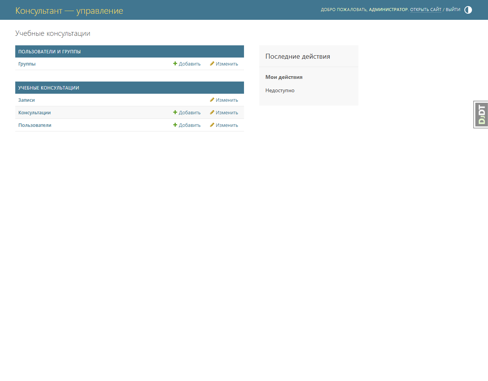
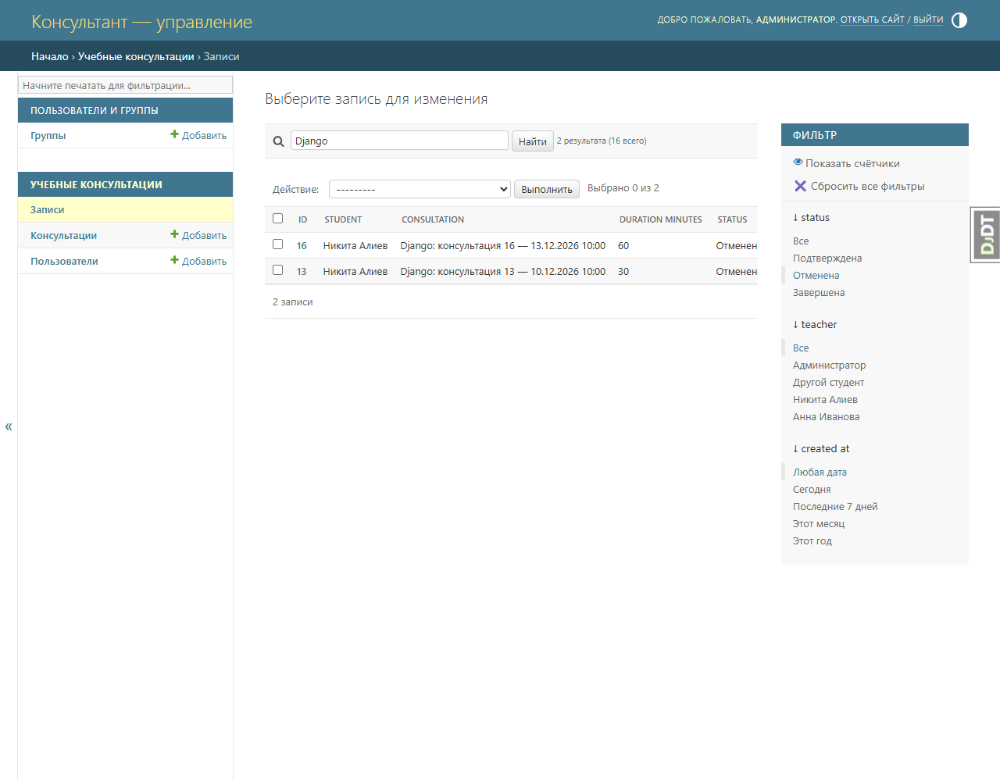
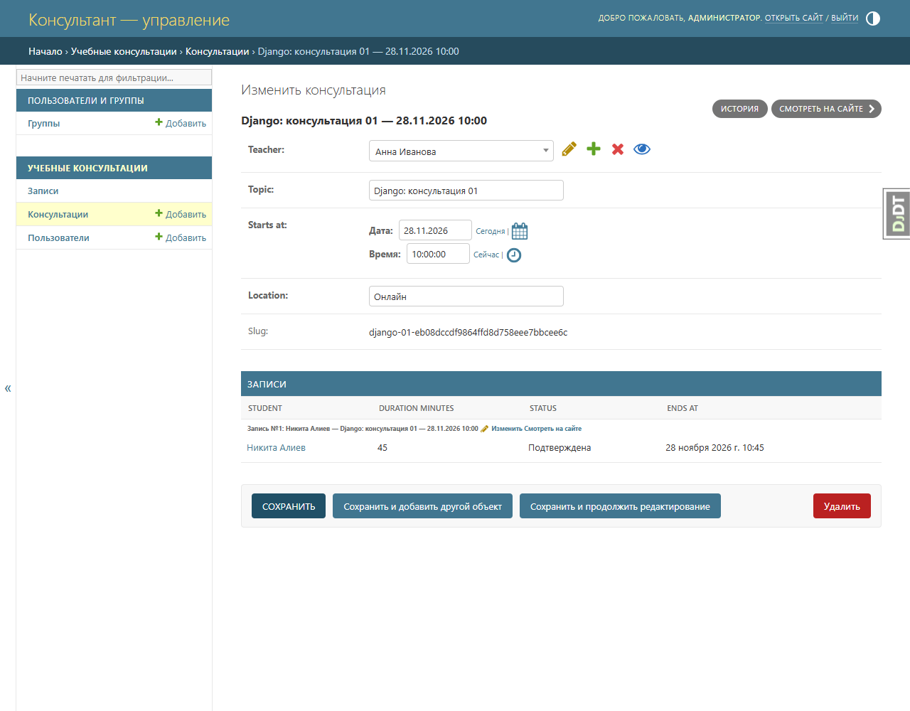
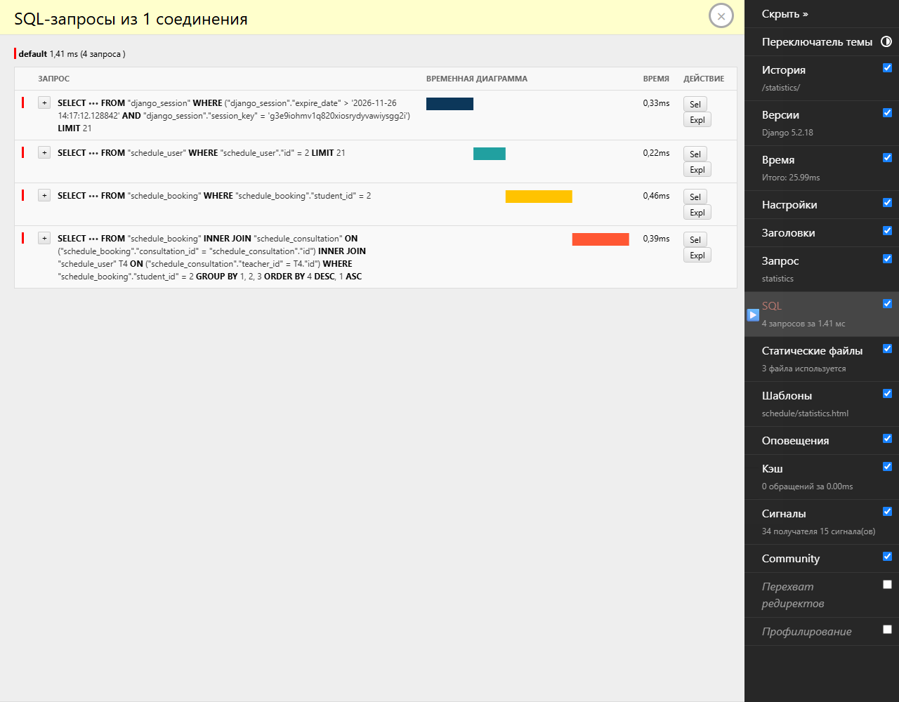

# Отчёт по практической работе №10

Административная панель Django и работа с данными через ORM

РТУ МИРЭА. Алиев Никита, ЭФБО-01-24. Вариант 1. Москва, 2026.

Отчёт относится ко всему этапу разработки индивидуального проекта «Система управления консультациями» (вариант 1). Примеры Roomly адаптированы: Room соответствует Consultation, бронирование - записи Booking, участник - User. Проверка выполнена 26.11.2026 на изолированной копии актуального кода с отдельной SQLite-базой; рабочие данные не изменялись.

## 1. Цель и учебные материалы

Настроить Django Admin для предметной области проекта, расширить средства запросов и проверить SQL, формируемый ORM. Применены темы административной панели, связанных моделей, фильтрации, сортировки, агрегирования, QuerySet и получения отдельных объектов. Темы учебного курса применены в индивидуальном проекте. Доступа к личному кабинету Яндекс Практикума и отметкам о завершении уроков нет; прохождение курса в данном отчёте не подтверждается. Подтверждается выполнение перечисленных ниже действий в коде и приложении.

## 2. Настройка административной панели

В schedule/admin.py зарегистрированы User, Consultation и Booking. Для User сохранён стандартный UserAdmin и добавлена учебная роль. Для консультаций настроены list_display, list_filter, search_fields, ordering, date_hierarchy, autocomplete_fields и list_select_related. Число записей выводится через Count. Админка получила русское название приложения и моделей.

BookingAdmin показывает студента, консультацию, длительность, статус и окончание; поддерживает поиск по студенту и теме, фильтры статуса, преподавателя и даты. В карточке консультации BookingInline показывает связанные записи только для чтения. Создание записей выполняется через пользовательскую форму, удаление истории в админке запрещено. Разрешены действия отмены и завершения уже закончившихся встреч.

Форма админки проверяет роль преподавателя и будущее время. Если у консультации есть записи, изменение преподавателя и начала отклоняется. Учебную роль пользователя со связанными данными нельзя менять через админку. Изменения расписания сбрасывают кэш после фиксации транзакции.

## 3. Модели, миграции и QuerySet

Booking.Status реализует TextChoices: active, cancelled, completed. Миграция 0002 сохраняет прежние отмены при переходе от BooleanField к статусу; 0003/0004 сохраняют учебное изменение длины поля. Пользовательский QuerySet подключён как менеджер модели:

```text
def active(self):
    return self.filter(status="active")

def with_details(self):
    return self.select_related("student", "consultation__teacher")
```

for_user ограничивает выборку текущим студентом либо преподавателем; on_date фильтрует по дате консультации. Методы применяются в API, HTML-представлениях и диагностике. __str__ формирует понятные подписи. У консультации настроены slug, get_absolute_url и именованный маршрут; админка предоставляет переход на публичную страницу.

## 4. Запросы, фильтры и статистика

Журнал сочетает GET-фильтры по периоду, преподавателю и статусу, поиск с Q, разрешённую сортировку и Paginator на 10 записей. Параметры сохраняются в ссылках страниц. На проверочных данных показана вторая страница активных записей. Статистика использует aggregate с условными Count для каждого статуса и Sum длительностей; группировка values().annotate() считает записи по преподавателям.

## 5. Доступность и статусы

Свободной считается будущая консультация без активной записи. Используются active().exists() и Exists с OuterRef. Отменённая запись остаётся в истории, но больше не блокирует слот. Проверка временных пересечений учитывает одновременно студента и преподавателя. Повторная запись на занятое время отклонена; после отмены время допускает новую запись. Завершение - явное административное действие только для прошедшей встречи, а не автоматический таймер.

## 6. Анализ SQL и оптимизация

Django Debug Toolbar включён только в режиме разработки отдельной переменной; в тестах отключён. В браузере открыта SQL-панель страницы статистики. Команда inspect_orm сравнила одинаковые 10 записей: без оптимизации чтение студента, консультации и преподавателя потребовало 31 SQL-запрос; with_details/select_related выполнил то же чтение одним запросом с JOIN. Это измерение получено на демонстрационной SQLite-базе, не является нагрузочным тестом PostgreSQL.

```text
N+1 optimized=False: rows=10, SQL queries=31
N+1 optimized=True: rows=10, SQL queries=1
```

## 7. Проверки и Git

check не обнаружил проблем; рассогласований моделей и миграций нет. Успешны 48 Django-тестов и 53 теста консольной части. В браузере проверены список моделей админки, поиск/фильтр записей, inline, журнал с пагинацией и статистика. Полный flake8 выявил 99 замечаний форматирования в служебных файлах и исходной миграции.

Контрольная точка разработки: [коммит 48ac918](https://github.com/NikiVence/consult_managing/commit/48ac9189a602570478acac3f4f5a926eb9517c1e). В нём сохранены веб-приложение, миграции 0001-0004, тесты, Bootstrap и документация. [Репозиторий проекта](https://github.com/NikiVence/consult_managing); [история изменений](https://github.com/NikiVence/consult_managing/commits/main/).

## 8. Вывод

Админка предоставляет управление сущностями и просмотр связей с учётом бизнес-правил. Запросы ORM, статусы и доступность согласованы с пользовательскими сценариями. select_related устраняет измеренную проблему N+1. GeneratedField, изображения помещений и дополнительный контекстный процессор не вводились: для данного функционала они не требуются. Учебные отметки Практикума подтверждаются отдельно.

## Приложение А. Административный интерфейс





## Приложение Б. Связи и постраничный вывод




## Приложение В. Статистика и SQL




## Приложение. Протокол проверок от 26.11.2026

Ниже приведены выдержки из фактического вывода команд, выполненных на отдельной копии проекта. Это текстовый протокол, а не изображение терминала. Полные журналы приложены в evidence_full; скриншоты интерфейса получены запуском приложения в Edge.

## Системная проверка и миграции

```text
python webapp/manage.py check
System check identified no issues (0 silenced).

python webapp/manage.py makemigrations --check --dry-run
No changes detected

python webapp/manage.py showmigrations schedule
[X] 0001_initial
[X] 0002_alter_booking_options_alter_consultation_options_and_more
[X] 0003_alter_consultation_location
[X] 0004_alter_consultation_location
```

## Автоматизированные тесты

```text
python webapp/manage.py test schedule --noinput
Ran 48 tests in 2.310s
OK

python -m pytest -v -p no:cacheprovider
53 passed in 0.76s
```

## Проверка оформления

```text
python -m flake8 . --extend-exclude=venv,.venv,.runtime,.git --jobs=1
Exit code: 1
```

Найдено 99 замечаний E501 (длинные строки) и E231 (пробелы после разделителей). Основные источники: tools/browser_check.py, tools/build_api_docs.py, tools/load_check.py и миграция 0001_initial.py. Они не отменяют успешный результат функциональных тестов; весь репозиторий не объявляется прошедшим flake8.

## Воспроизводимость

Среда: Python 3.12, Django 5.2.18, SQLite, Edge/Playwright. Для проверки подготовлены отдельные демонстрационные аккаунты и консультации. Рабочая база D:\consult_managing не изменялась. Проверка PostgreSQL под конкурентной нагрузкой в этот протокол не входит.
