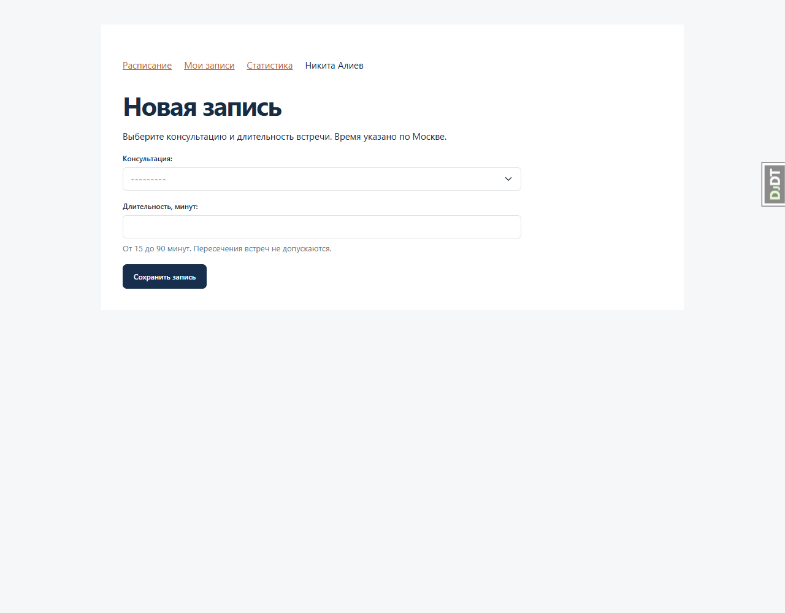
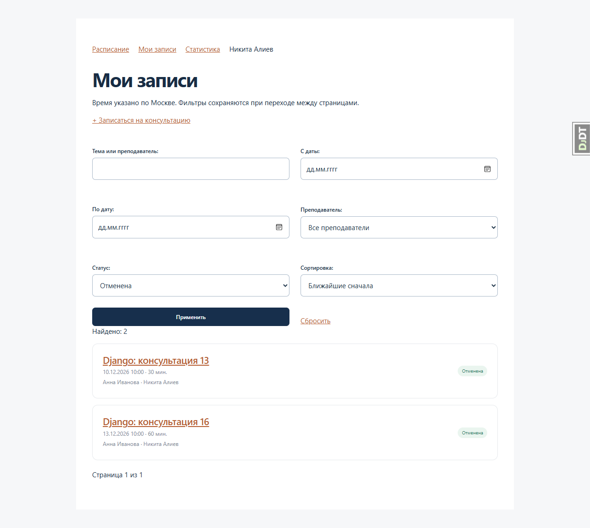
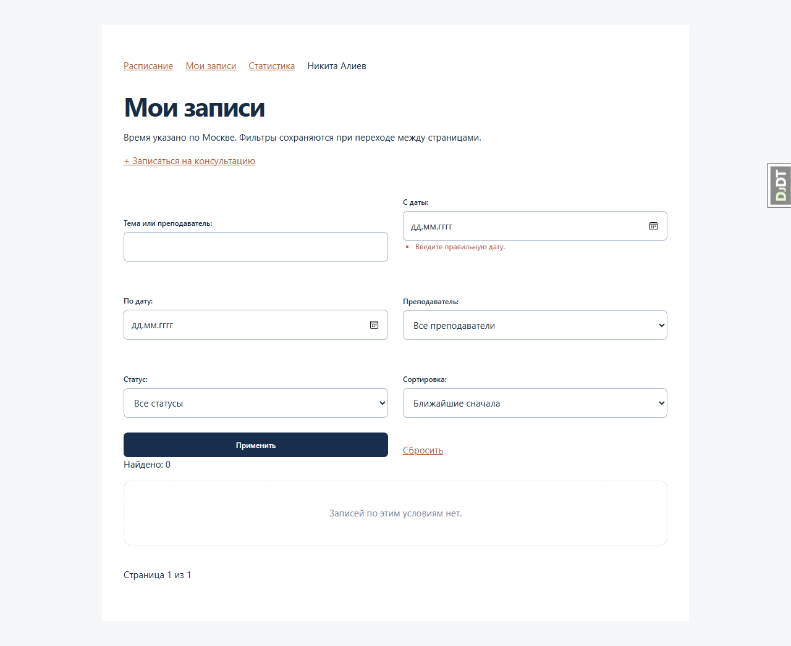
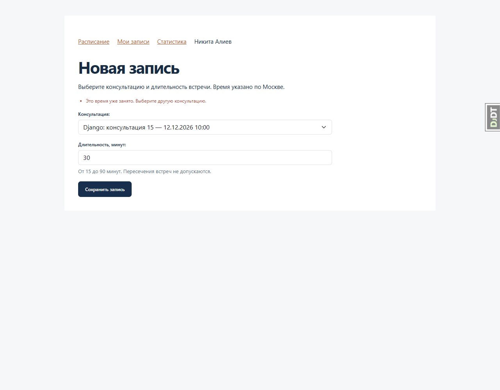
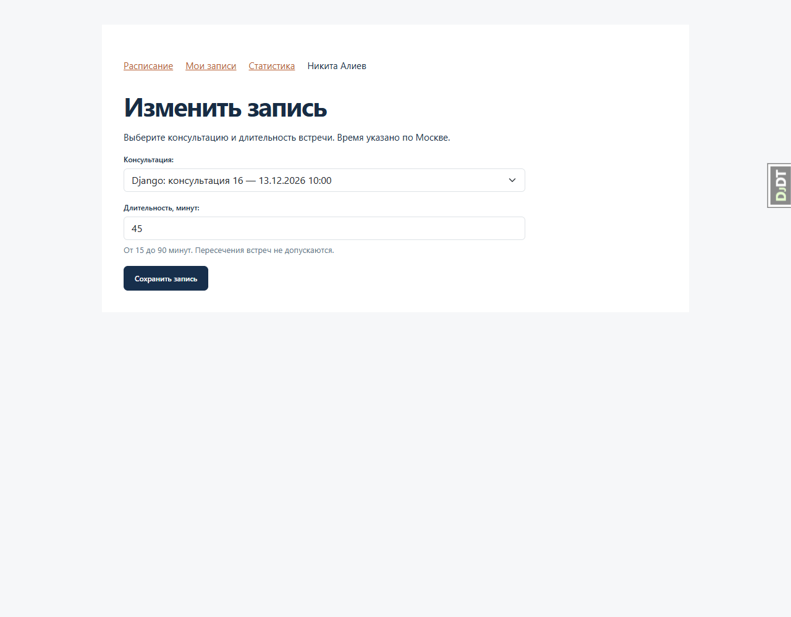
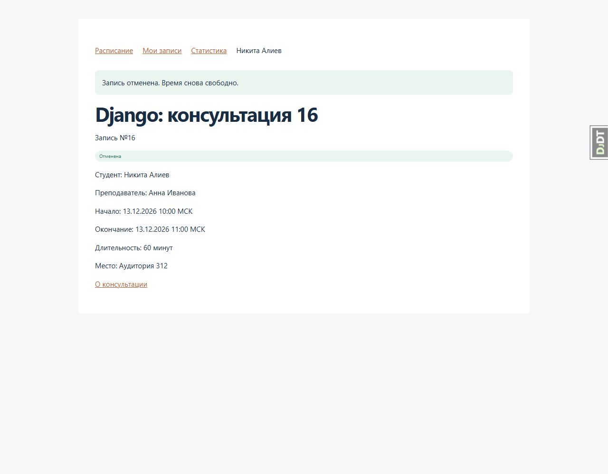
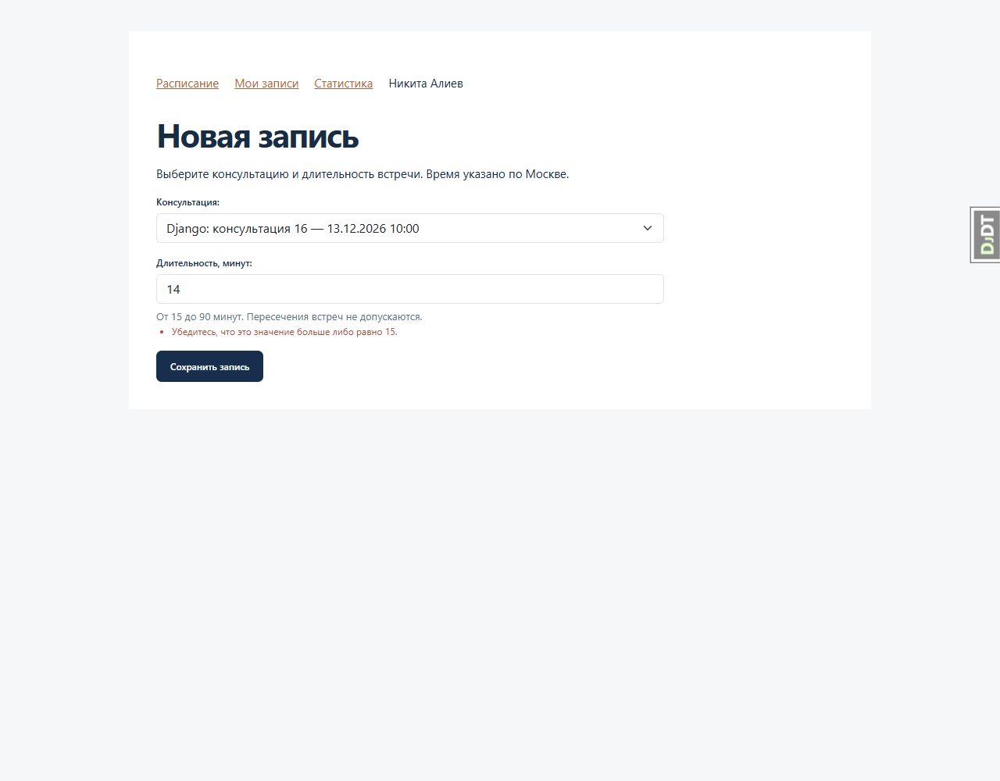
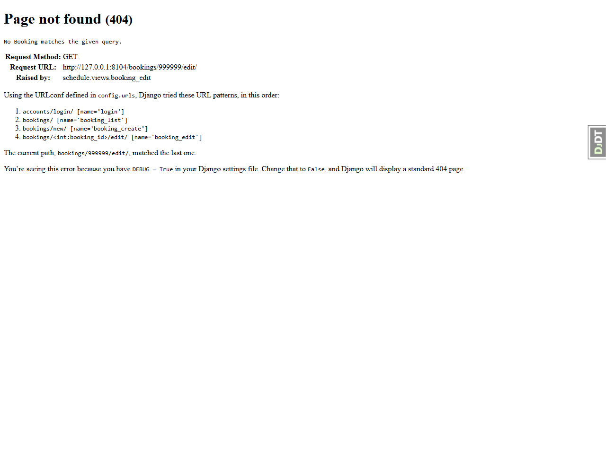

# Отчёт по практической работе №11

Формы в Django

РТУ МИРЭА. Алиев Никита, ЭФБО-01-24. Вариант 1. Москва, 2026.

Отчёт относится ко всему этапу разработки индивидуального проекта «Система управления консультациями» (вариант 1). Примеры Roomly адаптированы: Room соответствует Consultation, бронирование - записи Booking, участник - User. Проверка выполнена 26.11.2026 на изолированной копии актуального кода с отдельной SQLite-базой; рабочие данные не изменялись.

## 1. Цель и учебные материалы

Реализовать получение, проверку и сохранение пользовательских данных средствами Form и ModelForm, встроить формы в существующие сценарии консультаций. Применены поля, виджеты, GET/POST, cleaned_data, пользовательская валидация, вывод ошибок, создание и редактирование модели. Темы учебного курса применены в индивидуальном проекте. Доступа к личному кабинету Яндекс Практикума и отметкам о завершении уроков нет; прохождение курса в данном отчёте не подтверждается. Подтверждается выполнение перечисленных ниже действий в коде и приложении.

## 2. Созданные формы и отображение

| Форма | Назначение и настройки |
|---|---|
| BookingFilterForm | forms.Form: q, date_from, date_to, teacher, status, sort. Поиск и фильтрация без изменения базы. |
| BookingForm | ModelForm для Booking; пользователю доступны consultation и duration_minutes. Студент, статус и окончание назначаются сервером. |
| Форма входа | AccountLoginView использует стандартную форму аутентификации и общий с API лимит попыток. |

В BookingForm заданы labels, help_text, NumberInput и Select. min/max передаются в HTML, min_value/max_value выполняют серверную проверку. Bootstrap 5.3.3 подключён локально: form-control для числа, form-select для списка. Поля выводятся по отдельности с label, help_text, field.errors и form.non_field_errors. Это позволяет различать ошибки значения и общие конфликты.

## 3. Фильтрация через GET

booking_list передаёт request.GET в BookingFilterForm. После is_valid используются только cleaned_data. ModelChoiceField проверяет выбранного преподавателя, DateField преобразует дату, ChoiceField ограничивает сортировку. clean отклоняет диапазон с началом позже конца. Ошибочные значения дают сообщения формы и пустую выборку без исключения сервера. Фильтры применяются до сортировки и пагинации; querystring сохраняет их при переходе между страницами.

## 4. Валидация даты и доступности

В проекте дата встречи принадлежит Consultation: студент выбирает готовый будущий слот. clean_consultation проверяет будущее время; варианты ModelChoiceField также ограничены будущими консультациями преподавателей. Длительность допускается только от 15 до 90 минут. clean вызывает общую проверку занятости и пересечений времени студента/преподавателя. Ошибка даты фильтра и ошибка занятого слота показаны в приложении.

## 5. Создание и редактирование

Представление booking_edit обслуживает /bookings/new/ и /bookings/<id>/edit/. GET показывает форму, POST передаёт request.POST для проверки. При редактировании get_object_or_404 получает запись, проверяется владелец и допустимость изменения, затем используется instance=booking. Сохранение без изменения слота не считается конфликтом: текущий PK исключён из выборки занятости.

save_booking_form повторно проверяет доступность внутри transaction.atomic с блокировкой участников. form.save(commit=False) создаёт подготовленный объект без немедленной записи; сервер назначает student, status и ends_at, затем вызывает save. После успеха выполняется перенаправление на карточку. При RuleError либо конфликте уникальности форма отображается повторно с сообщением. Отдельные тесты проверяют занятость, появившуюся после первичной проверки, и устаревшую форму отменённой записи.

## 6. Отмена и защита действий

Отмена выполняется POST-запросом с CSRF-токеном через cancel_booking. Статус становится cancelled; объект и история остаются в базе, слот освобождается. Студент может отменить свою запись, преподаватель - запись на свою консультацию. Чужая запись возвращает 403, отсутствие объекта - 404. GET на адрес отмены возвращает 405, POST без CSRF - 403. Завершённую встречу отменить нельзя.

## 7. Результаты проверки

| Сценарий | Фактический результат |
|---|---|
| Создание / изменение | Создана запись на 45 минут; изменение на 60 минут сохранило ту же запись. |
| Ошибки | 14 минут отклонены; занятый слот вызвал общую ошибку; некорректная дата фильтра вызвала ошибку поля. |
| Отмена / отсутствие | Отмена показала статус «Отменена»; неизвестный ID дал HTTP 404. |
| Автоматические проверки | check: 0 проблем; Django: 48 тестов OK; pytest: 53 passed; миграции согласованы. |

## 8. Git и вывод

Контрольная точка разработки: [коммит 48ac918](https://github.com/NikiVence/consult_managing/commit/48ac9189a602570478acac3f4f5a926eb9517c1e). В нём сохранены веб-приложение, миграции 0001-0004, тесты, Bootstrap и документация. [Репозиторий проекта](https://github.com/NikiVence/consult_managing); [история изменений](https://github.com/NikiVence/consult_managing/commits/main/).

Формы интегрированы в общий слой правил с API: они валидируют данные, сохраняют изменения и отображают ошибки. Загрузка файлов/изображений не реализована: вложения не предусмотрены текущей предметной областью, соответствующий пункт методички условный. Полный flake8 сохраняет 99 замечаний оформления, а подтверждение прохождения курса предоставляется отдельно.

## Приложение А. Форма и фильтрация





## Приложение Б. Проверка пользовательского ввода





## Приложение В. Изменение и отмена записи





## Приложение Г. Граничные сценарии





## Приложение. Протокол проверок от 26.11.2026

Ниже приведены выдержки из фактического вывода команд, выполненных на отдельной копии проекта. Это текстовый протокол, а не изображение терминала. Полные журналы приложены в evidence_full; скриншоты интерфейса получены запуском приложения в Edge.

## Системная проверка и миграции

```text
python webapp/manage.py check
System check identified no issues (0 silenced).

python webapp/manage.py makemigrations --check --dry-run
No changes detected

python webapp/manage.py showmigrations schedule
[X] 0001_initial
[X] 0002_alter_booking_options_alter_consultation_options_and_more
[X] 0003_alter_consultation_location
[X] 0004_alter_consultation_location
```

## Автоматизированные тесты

```text
python webapp/manage.py test schedule --noinput
Ran 48 tests in 2.310s
OK

python -m pytest -v -p no:cacheprovider
53 passed in 0.76s
```

## Проверка оформления

```text
python -m flake8 . --extend-exclude=venv,.venv,.runtime,.git --jobs=1
Exit code: 1
```

Найдено 99 замечаний E501 (длинные строки) и E231 (пробелы после разделителей). Основные источники: tools/browser_check.py, tools/build_api_docs.py, tools/load_check.py и миграция 0001_initial.py. Они не отменяют успешный результат функциональных тестов; весь репозиторий не объявляется прошедшим flake8.

## Воспроизводимость

Среда: Python 3.12, Django 5.2.18, SQLite, Edge/Playwright. Для проверки подготовлены отдельные демонстрационные аккаунты и консультации. Рабочая база D:\consult_managing не изменялась. Проверка PostgreSQL под конкурентной нагрузкой в этот протокол не входит.
