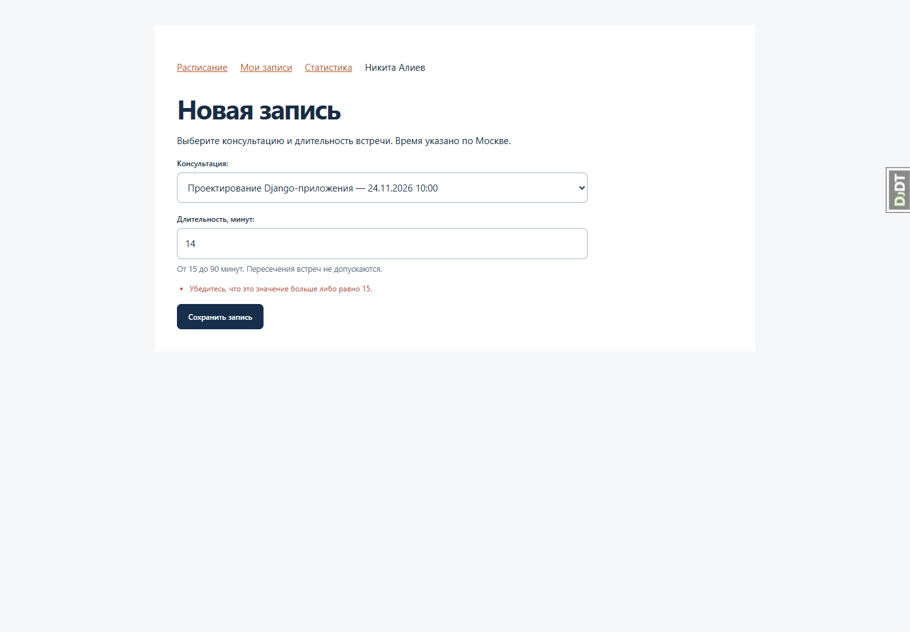

# Практическая работа №11

**Формы в Django.** Алиев Никита, ЭФБО-01-24, 2026 г.

Дисциплина: «Технологии разработки приложений на базе фреймворков». Проект: «Система управления консультациями».

## Цель

Реализовать фильтрацию и изменение записей через `Form` и `ModelForm`, обеспечить серверную валидацию и безопасную обработку GET/POST.

## Выполненная работа

В `schedule/forms.py` создана `BookingFilterForm(forms.Form)`: строка поиска, даты начала/конца периода, преподаватель, статус и сортировка. Значения берутся из `request.GET`, проверяются `is_valid()`, затем используются только из `cleaned_data`. `ModelChoiceField` проверяет преподавателя, `ChoiceField` ограничивает сортировку; `clean()` отклоняет обратный диапазон дат. При ошибке отображается форма с сообщением, исключение не попадает пользователю.

`BookingForm(ModelForm)` включает консультацию и длительность. Студент определяется по сессии, а статус и окончание — на сервере. Поля снабжены русскими подписями, виджетами и подсказками. Длительность ограничена 15–90 минутами. `clean_consultation()` проверяет будущее время; `clean()` проверяет доступность и пересечения студента/преподавателя. Общие и полевые ошибки выводятся отдельно, введённые значения сохраняются.

Страницы `/bookings/new/` и `/bookings/<id>/edit/` показывают форму по GET и обрабатывают её по POST. При редактировании передаётся `instance=booking`, текущая запись исключается из поиска конфликтов. Перед сохранением проверки повторяются внутри транзакции с блокировкой участников; используется `form.save(commit=False)`, назначение серверных значений и `save()`. После успеха выполняется redirect на карточку записи.

Отмена доступна только по POST с CSRF и изменяет статус, не удаляя историю. Освободившееся время можно забронировать снова. Чужие записи защищены ответом 403, несуществующие объекты — 404. Все HTML-формы изменения используют `csrf_token`; серверная форма входа использует общий с API лимит попыток.

## Проверка

Автоматически проверены валидация, подмена пользователя/статуса, конфликт при редактировании, конфликт после первичной проверки формы, устаревшая форма отменённой записи, доступ и CSRF. В Edge выполнен цикл создания, изменения длительности и отмены. Проверена мобильная ширина 390 px.

## Вывод

Формы интегрированы в существующее приложение и используют общие с API правила. Загрузка файлов не реализовывалась: вложения не предусмотрены текущей системой консультаций, соответствующий пункт чек-листа условный. Прохождение материалов Практикума подтверждается личным аккаунтом. Исходный код и история изменений доступны в Git-репозитории проекта.

## Дополнение: Bootstrap

Подключён локальный Bootstrap 5.3.3: NumberInput использует form-control, Select — form-select. Для демонстрации изменения виджета можно временно добавить placeholder или класс form-control-lg, после чего вернуть исходные настройки. Подключение не требует интернета.

## Git-репозиторий

[Исходный код проекта](https://github.com/NikiVence/consult_managing) · [История коммитов](https://github.com/NikiVence/consult_managing/commits/main/) · [Отчёты ПР9–11](https://github.com/NikiVence/consult_managing/tree/main/docs/framework_pr9_11).
