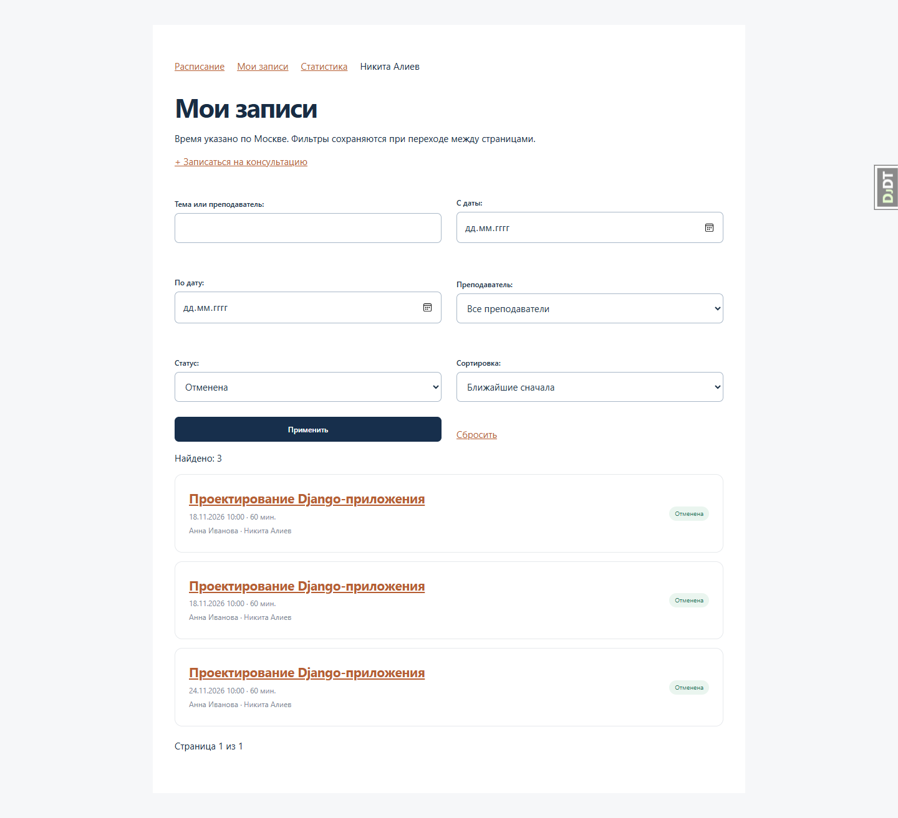

# Практическая работа №9

**Модели Django и Django ORM.** Алиев Никита, ЭФБО-01-24, 2026 г.

Дисциплина: «Технологии разработки приложений на базе фреймворков». Индивидуальный проект: «Система управления консультациями».

## Цель

Организовать работу с сущностями и связями через Django ORM, сохранить данные существующего приложения и реализовать выборки с фильтрацией, сортировкой и пагинацией.

## Выполненная работа

Продолжено приложение `webapp/schedule`. Пользователь `User` наследуется от `AbstractUser` и имеет учебную роль. `Consultation` хранит преподавателя, тему, дату, место и уникальный адрес `slug`. `Booking` связывает студента и консультацию, хранит длительность, окончание, статус и дату создания. Связи `ForeignKey` используют `PROTECT`, поэтому нельзя удалить участника или консультацию вместе с историей записей. Обратные связи доступны через `slots` и `bookings`.

В исходной версии уже применялась миграция `0001_initial`. Повторный импорт из JSON/консольной реализации не нужен: рабочая база уже содержит ORM-таблицы. Добавлена миграция `0002`, которая сохраняет идентификаторы и связи, переводит флаг отмены в статус и заполняет уникальные slug до включения ограничения уникальности. Активные и отменённые записи сохраняют смысл. Консольные модули сохранены как отдельный предыдущий этап проекта.

В журнале `/bookings/` реализованы поиск по теме и преподавателю, фильтры по периоду, преподавателю и статусу, три разрешённых варианта сортировки. На странице выводится 10 записей. `Paginator` и тег `querystring` сохраняют фильтры при переходе между страницами. Доступ ограничен записями текущего студента или консультациями текущего преподавателя.

Страница `/statistics/` использует `aggregate()`, условные `Count` и группировку `values().annotate()`. Связанные данные загружаются через `select_related()`. Команда `inspect_orm` содержит 18 исполняемых выражений: чтение набора/объекта, фильтрацию, `exclude`, поиск с `Q`, сортировку, связи, агрегирование, группировку, пагинацию и проверку доступности с `Exists`.

## Проверка и результат

Проверены миграция копии существующей базы, отсутствие новых несозданных миграций, системные проверки Django, 48 Django-тестов и 53 теста консольной части. Автоматический миграционный тест отдельно подтверждает сохранение отмен, идентификаторов и связей. Старые API-сценарии сохранены.

## Вывод

Проект использует ORM для пользовательских сценариев и статистики; схема управляется миграциями. Связи и история записей сохраняются при обновлении. Темы Практикума «Отношения между таблицами» и «Django ORM. Модели» представлены соответствующими конструкциями проекта; прохождение курса подтверждается личным аккаунтом. Исходный код и история изменений доступны в Git-репозитории проекта.

## Git-репозиторий

[Исходный код проекта](https://github.com/NikiVence/consult_managing) · [История коммитов](https://github.com/NikiVence/consult_managing/commits/main/) · [Отчёты ПР9–11](https://github.com/NikiVence/consult_managing/tree/main/docs/framework_pr9_11).

При демонстрации миграций созданы 0003 и 0004: максимальная длина location увеличена со 120 до 150, затем возвращена к 120. Файлы сохраняют последовательную историю учебного изменения.
