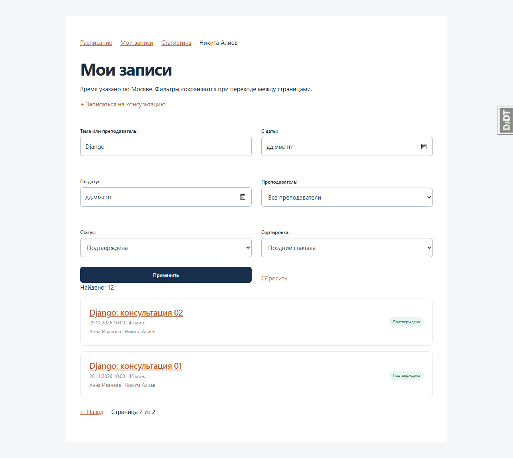
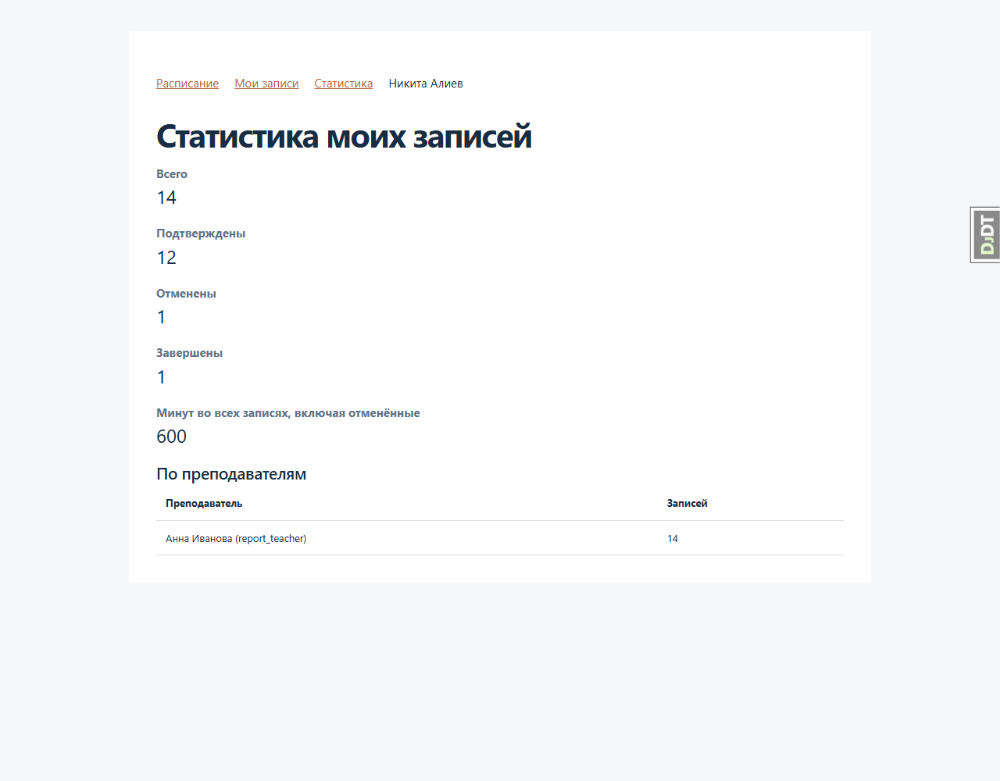

# Отчёт по практической работе №9

Модели Django и Django ORM

РТУ МИРЭА. Алиев Никита, ЭФБО-01-24. Вариант 1. Москва, 2026.

Отчёт относится ко всему этапу разработки индивидуального проекта «Система управления консультациями» (вариант 1). Примеры Roomly адаптированы: Room соответствует Consultation, бронирование - записи Booking, участник - User. Проверка выполнена 26.11.2026 на изолированной копии актуального кода с отдельной SQLite-базой; рабочие данные не изменялись.

## 1. Цель и исходное состояние

Освоить описание сущностей и связей моделями Django, управление схемой миграциями и выполнение операций с данными через ORM. Продолжен существующий проект: консольная часть сохранена, веб-часть расположена в webapp/schedule. К началу этого этапа веб-приложение уже использовало Django ORM и миграцию 0001_initial.

## 2. Учебные материалы

Раздел 05 «База данных и Django ORM»: «Отношения между таблицами», «Django ORM. Модели». В проекте применены внешние ключи, обратные связи, типы полей, миграции и QuerySet. Темы учебного курса применены в индивидуальном проекте. Доступа к личному кабинету Яндекс Практикума и отметкам о завершении уроков нет; прохождение курса в данном отчёте не подтверждается. Подтверждается выполнение перечисленных ниже действий в коде и приложении.

## 3. Модели и связи

| Модель | Данные и назначение |
|---|---|
| User | AbstractUser: логин, имя, пароль в виде хеша; role: student/teacher. |
| Consultation | teacher, topic, starts_at, location, уникальный slug. Предложенное преподавателем время встречи. |
| Booking | student, consultation, duration_minutes, ends_at, status, created_at. Запись студента на встречу. |

ForeignKey связывает консультацию с преподавателем, запись - со студентом и консультацией. PROTECT препятствует удалению объектов, на которые ссылается история. Обратные связи называются slots и bookings. Ограничения базы: уникальность пары преподаватель/начало, одна активная запись на консультацию, длительность 15-90 минут. Доступ к журналу ограничен текущим пользователем.

## 4. Миграции и сохранение данных

Миграция 0002 добавляет статусы и slug: сначала создаются поля, затем RunPython переносит отмены и заполняет идентификаторы, после чего удаляется старый флаг и включается уникальность. Данные существующей ORM-базы обновляются на месте; отдельный повторный импорт JSON или SQL-таблиц предыдущего этапа не выполнялся. Миграционный тест подтверждает сохранение ID, связей и отмен.

Учебные миграции 0003 и 0004 увеличивают max_length поля location со 120 до 150, затем возвращают 120. На основной базе все четыре миграции отмечены [X]. Изменения состояния поля отражены в истории; SQLite не гарантирует ограничение длины VARCHAR на уровне хранения.

## 5. Реализованные операции и страницы

В пользовательских сценариях используются создание записи, изменение длительности/консультации и отмена через изменение статуса. Физическое удаление исторических записей в админке запрещено; консультации без зависимых записей могут удаляться администратором. Ранее реализованные API и консольные сценарии сохранены.

| Направление | Реализация |
|---|---|
| Чтение и фильтрация | all/get, filter по роли, времени, статусу и связанному преподавателю; exclude, Q и Exists. |
| Поиск и сортировка | Тема и поля преподавателя; order_by по времени, имени и ID. Значения сортировки берутся из разрешённого словаря. |
| Связи и статистика | select_related; values/values_list; aggregate, Count, Sum; values().annotate() по преподавателям и статусам. |
| Пагинация | Paginator: 10 записей на страницу. querystring сохраняет поиск, фильтры и сортировку при переходе. |

Журнал /bookings/ получает QuerySet и передаёт page_obj в шаблон. /statistics/ выводит сводные показатели и группировку. Подробная страница консультации открывается по slug. inspect_orm выполняет 18 разных выражений чтения и выводит сформированный SQL. README дополнен запуском, проверками и ссылками на материалы.

## 6. Проверка и результат

check: ошибок нет; makemigrations --check --dry-run: No changes detected; migrate: 0001-0004 применились к новой проверочной базе. Django: 48 тестов OK; pytest -v: 53 passed. Проверены формы, приватность, CSRF, пересечения времени и перенос старых отмен. Полный flake8 завершился с кодом 1: 99 замечаний E501/E231 преимущественно в служебных tools и исходной миграции; успешная линт-проверка всего репозитория не заявляется.

## 7. Контрольная точка Git

Контрольная точка разработки: [коммит 48ac918](https://github.com/NikiVence/consult_managing/commit/48ac9189a602570478acac3f4f5a926eb9517c1e). В нём сохранены веб-приложение, миграции 0001-0004, тесты, Bootstrap и документация. [Репозиторий проекта](https://github.com/NikiVence/consult_managing); [история изменений](https://github.com/NikiVence/consult_managing/commits/main/).

## 8. Вывод

Сущности проекта описаны моделями с проверяемыми связями и ограничениями. Схема изменяется последовательными миграциями, история записей сохраняется. ORM используется для чтения, изменения данных и статистики; фильтрация и постраничный вывод работают совместно. Функциональные проверки пройдены; замечания оформления кода и подтверждение учебного курса остаются отдельными пунктами.

## Приложение А. Журнал и сводные данные

Снимки реально работающей проверочной копии от 26.11.2026. Данные созданы специально для воспроизводимой демонстрации.





## Приложение. Протокол проверок от 26.11.2026

Ниже приведены выдержки из фактического вывода команд, выполненных на отдельной копии проекта. Это текстовый протокол, а не изображение терминала. Полные журналы приложены в evidence_full; скриншоты интерфейса получены запуском приложения в Edge.

## Системная проверка и миграции

```text
python webapp/manage.py check
System check identified no issues (0 silenced).

python webapp/manage.py makemigrations --check --dry-run
No changes detected

python webapp/manage.py showmigrations schedule
[X] 0001_initial
[X] 0002_alter_booking_options_alter_consultation_options_and_more
[X] 0003_alter_consultation_location
[X] 0004_alter_consultation_location
```

## Автоматизированные тесты

```text
python webapp/manage.py test schedule --noinput
Ran 48 tests in 2.310s
OK

python -m pytest -v -p no:cacheprovider
53 passed in 0.76s
```

## Проверка оформления

```text
python -m flake8 . --extend-exclude=venv,.venv,.runtime,.git --jobs=1
Exit code: 1
```

Найдено 99 замечаний E501 (длинные строки) и E231 (пробелы после разделителей). Основные источники: tools/browser_check.py, tools/build_api_docs.py, tools/load_check.py и миграция 0001_initial.py. Они не отменяют успешный результат функциональных тестов; весь репозиторий не объявляется прошедшим flake8.

## Воспроизводимость

Среда: Python 3.12, Django 5.2.18, SQLite, Edge/Playwright. Для проверки подготовлены отдельные демонстрационные аккаунты и консультации. Рабочая база D:\consult_managing не изменялась. Проверка PostgreSQL под конкурентной нагрузкой в этот протокол не входит.
