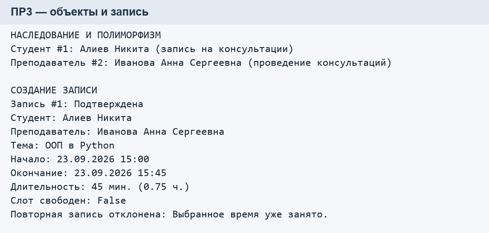
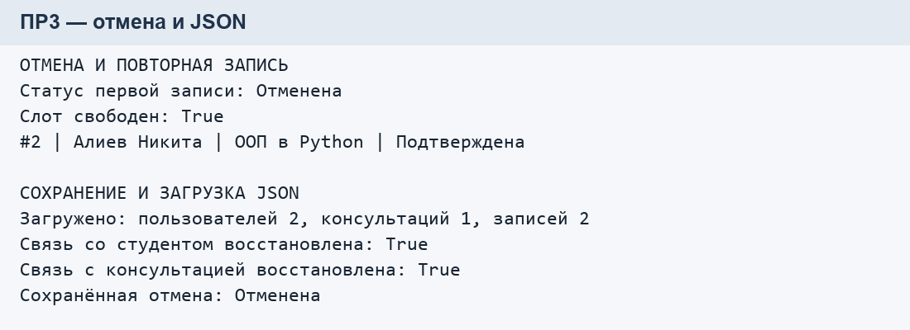

# Технологии разработки приложения на базе фреймворков

## ПРАКТИЧЕСКАЯ РАБОТА № 3

**ОБЪЕКТНО-ОРИЕНТИРОВАННОЕ ПРОГРАММИРОВАНИЕ В PYTHON. КЛАССЫ, ОБЪЕКТЫ И ВЗАИМОДЕЙСТВИЕ ОБЪЕКТОВ**

**ЭФБО-01-24. Алиев Никита. 2026 г.**

**Индивидуальный проект: «Система управления консультациями».**

---

## 1. Материалы Яндекс Практикума

Темы, предусмотренные ПР3 в разделе 03:

- Объекты и классы: введение в ООП; классы и объекты; собственные классы;
  атрибуты класса и объекта; методы; магический метод __str__; практика.
- Знакомство с ООП: принципы ООП; наследование; полиморфизм;
  инкапсуляция; практика.
- Расширенные возможности Python: декораторы; декораторы для методов
  класса; практика.

Прохождение тем подтверждается результатами в личном аккаунте Практикума.

## 2. Доработка индивидуального проекта

**Название:** «Система управления консультациями».

**Предметная область:** организация консультаций студентов с преподавателями,
управление расписанием, создание и отмена записей.

Проект продолжен в той же рабочей папке. Исходный вариант содержал сценарий
ПР1; отдельная реализация ПР2 отсутствовала. В ходе доработки добавлены
коллекции, меню, JSON-хранилище и объектная модель.

**Основные классы:**

- `User` — идентификатор и имя пользователя, проверка корректности данных.
- `Student` и `Teacher` — наследники User с разными ролями и строковым
  представлением; общая инициализация наследуется от базового класса.
- `Consultation` — идентификатор, преподаватель, тема и время начала;
  методы проверки будущей даты и допустимой длительности.
- `Booking` — запись, содержащая объекты студента и консультации,
  длительность и признак отмены; методы отмены и подтверждения.

Для основных сущностей реализованы `__init__` и `__str__`. Наследование
показано на ролях пользователей, полиморфизм — на переопределении `__str__`.
Инкапсуляция состояния записи реализована через `_is_cancelled`, метод
`cancel()` и свойство без сеттера. `@property` используется для статуса
и времени окончания; `@staticmethod` — для проверки длительности.

Проверка записи из ПР1 перенесена в методы и функцию `create_booking()`;
расчёт окончания — в `Booking.ends_at`; формирование подтверждения —
в `Booking.confirmation()`. Поиск, сортировка, загрузка и сохранение
остались отдельными функциями, поскольку работают с коллекциями и файлами.

JSON хранит идентификаторы связей. При загрузке сначала создаются пользователи,
затем консультации и записи со ссылками на общие объекты. Сохранены проверки
длительности, ввод, обработка ошибок и первоначальный сценарий записи.
Добавлены отмена, защита от повторной записи и пересечений по времени.

**Репозиторий проекта:** https://github.com/NikiVence/consult_managing

## 3. Результат работы

Программа предоставляет меню расписания, поиска, пользователей, создания
консультаций, проверки доступности, записи и отмены. Изменения сохраняются
в JSON и восстанавливаются между запусками. Повреждённый файл не заменяется
пустой базой; ошибка сохранения не меняет рабочие объекты.

*Рисунок 1 — Создание объектов и запись Алиева Никиты на консультацию.*

*Рисунок 2 — Отмена, повторная запись и восстановление связей из JSON.*

Иллюстрации оформлены из фактического вывода `demo.py`. Адаптированы
проверки прежнего сценария и добавлены тесты классов, JSON, связей объектов,
конфликтов и консольного меню. Пройдены 53 теста pytest; flake8 и Ruff
завершены без ошибок. README и описание архитектуры обновлены.
Результат работы представлен в репозитории проекта.

## 4. Вывод

Система управления консультациями преобразована в объектную модель.
Данные и поведение объединены в классах, организовано взаимодействие
объектов, реализовано постоянное хранение. Применены наследование,
полиморфизм и инкапсуляция. Проект подготовлен к дальнейшему развитию
в веб-приложение на Django.
